<h1 align="center">
  <br>
  
  <br>
  Samriddhi
  <br>
</h1>

<h4 align="center">See where your money stands, and get one clear next step, privately on your own device.</h4>

<p align="center">
  
  
  
  
</p>

<p align="center">
  <a href="#-what-it-does">What it does</a> •
  <a href="#-get-started">Get started</a> •
  <a href="#-how-it-works">How it works</a> •
  <a href="#-faq-and-troubleshooting">FAQ</a> •
  <a href="#%EF%B8%8F-for-developers">For developers</a>
</p>

<p align="center">
  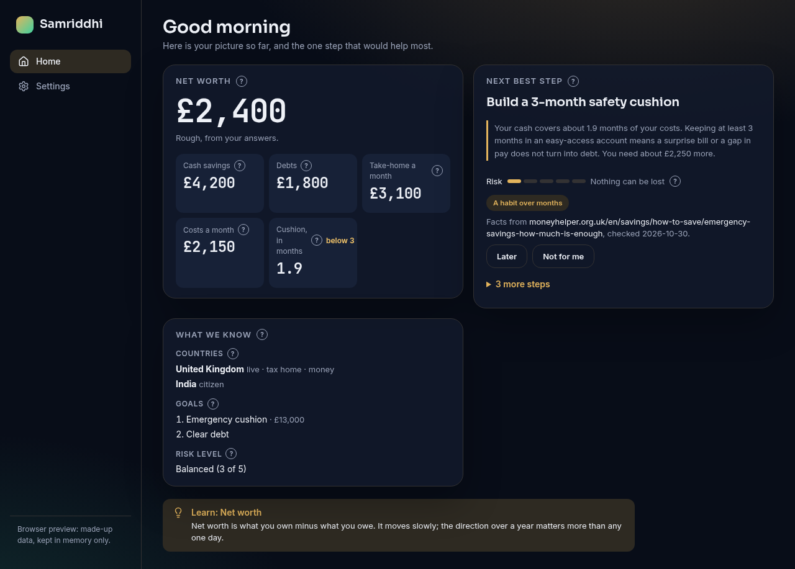
</p>

*Samriddhi* (समृद्धि) is Sanskrit for "abundance". The app is for anyone who wants a calm,
honest picture of their money and a nudge towards the one step that would help most. It
explains every figure and every suggestion in plain words, so you learn as you go.
Status: **pre-alpha**. There is no download yet; you can build it from source.

> [!NOTE]
> Samriddhi gives guidance and education, not regulated financial advice. It never moves
> money, links to a bank or places trades.

## ✨ What it does

- 🧭 **A short first-run guide** – seven screens ask about your countries, goals, money and
  risk. Each one says in one sentence why it asks, and most can be skipped.
- 💷 **A rough net worth** – your cash minus your debts, clearly marked "rough, from your
  answers". Amounts are kept exactly, never rounded.
- 👣 **One next best step** – from simple dated rules: a missing safety cushion, costly debt, or
  a fact still needed. Each shows its risk, effort and source. Put it off, turn it down with a
  reason, or bring it back later.
- ⚖️ **Risk in two parts** – how much risk you are comfortable with, and how much loss you could
  afford, shown apart in plain words. You can change your answers any time.
- ❓ **Explain on every figure** – tap the **?** beside any number to see what it means. Every
  screen also has a short "Learn" hint.
- 🔐 **Locked on your device** – an encrypted store (only your keys can read it), a recovery key,
  an optional PIN, and fingerprint or face unlock on Android.
- 🗄️ **Backups you control** – a daily encrypted backup, backups on demand, a second folder,
  and restore with a preview of what comes back.
- 📤 **Your data, your copy** – export everything as JSON or CSV, and import it again with a
  count of what will change first.
- 🎨 **Three looks** – Swarna (night navy and gold), Bahi (cream ledger with red ink) and Vana
  (airy mint and periwinkle), each in light and dark, with a calm-motion setting.

## 📸 Screenshots

| | | |
| :---: | :---: | :---: |
| 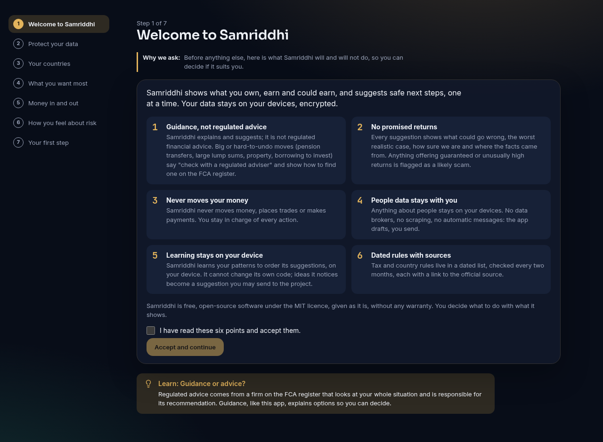<br>Welcome and safety points | 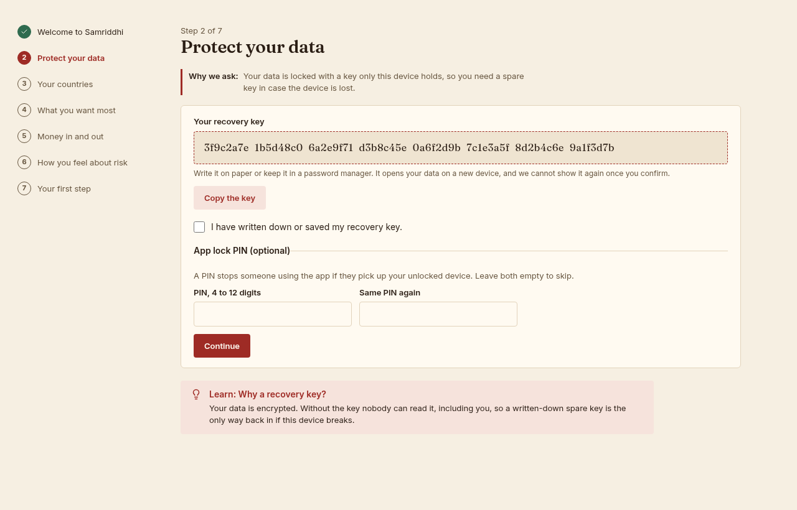<br>Recovery key and PIN | 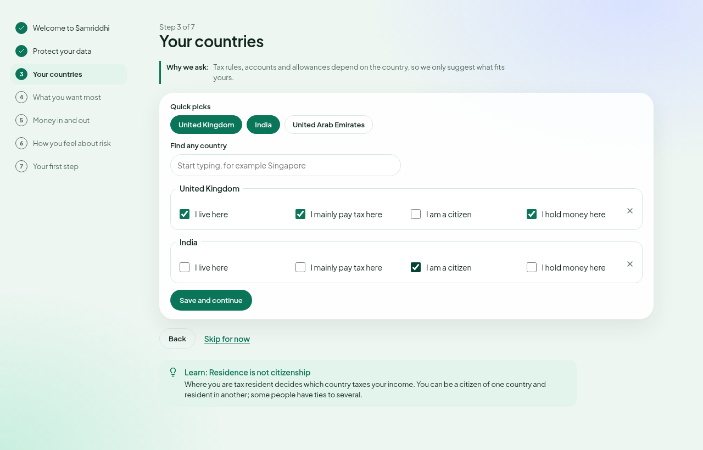<br>Your countries |
| 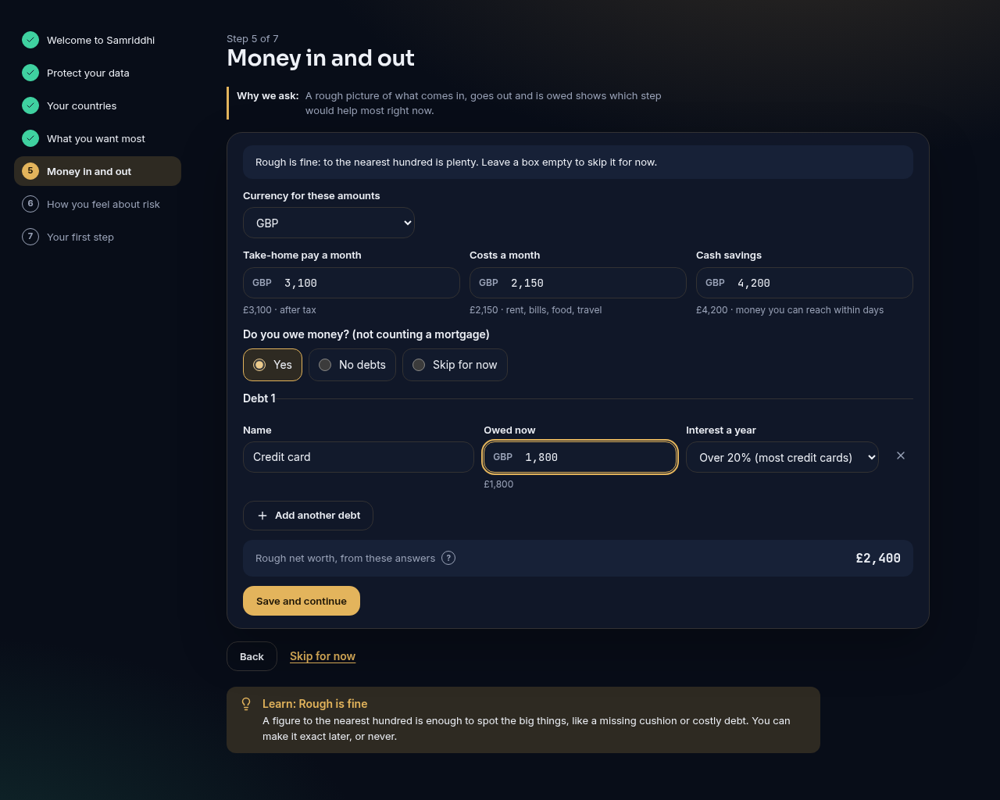<br>Money in and out | 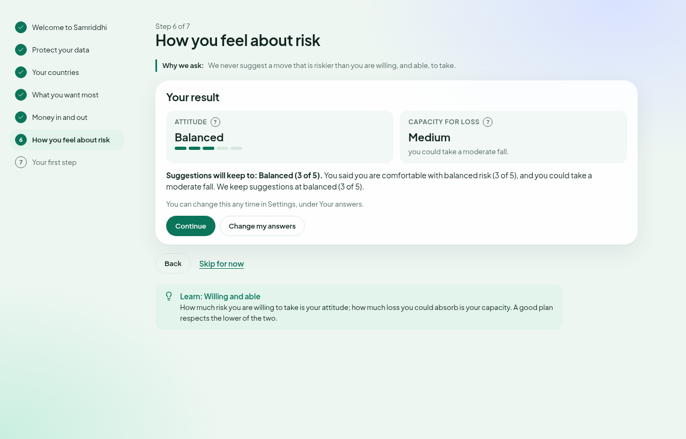<br>Risk, in two parts | 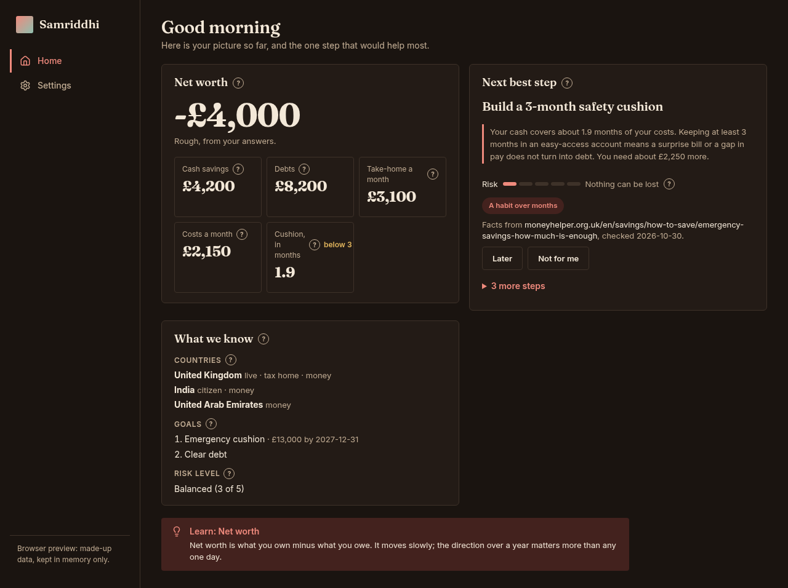<br>Home in Bahi, dark |
| 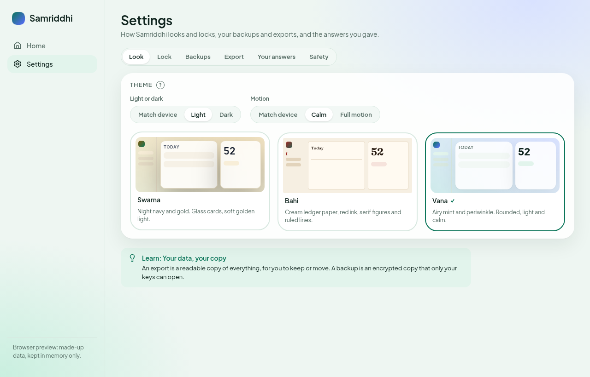<br>Pick a look | 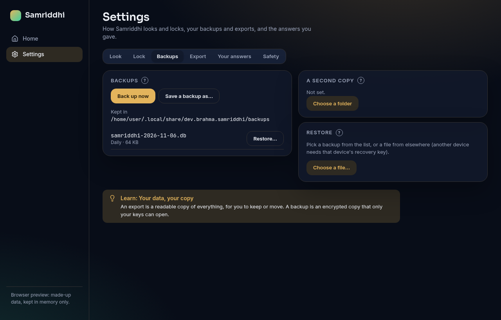<br>Backups | 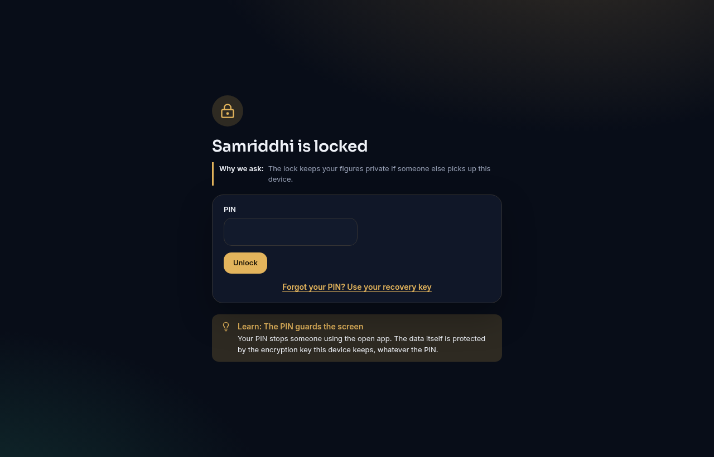<br>Unlock |

All screenshots use made-up demo data. Every wizard screen, home and settings are in
[`docs/screenshots`](docs/screenshots) for all three looks.

## 🚀 Get started

There is no release to download yet. Until there is, build the app yourself.

1. **Install the tools.** You need [Rust](https://rustup.rs), [Node.js](https://nodejs.org)
   22 or newer, and the [Tauri system packages](https://tauri.app/start/prerequisites/) for
   your computer.
2. **Get the code.** Download this repository and open a terminal in its folder.
3. **Install the parts.** Type `npm ci` and wait until it finishes.
4. **Start the app.** Type `cd app && npx tauri dev`. A window opens.

<details>
<summary><b>Just look around, without installing Rust</b></summary>

1. Type `npm ci`, then `npm run dev`.
2. Open the address it prints, for example `http://localhost:5173/`, in a browser.
3. The browser runs a stand-in with made-up data, kept in memory only. Add `?demo=home` to the
   address to skip straight to a finished set-up.
</details>

### First launch

The first-run guide has seven steps:

1. **Welcome** – six safety points. Tick the box to accept them.
2. **Protect your data** – press **Create my encrypted store**. Write down the recovery key,
   then add a PIN if you want one.
3. **Your countries** – where you live, pay tax, hold money or are a citizen.
4. **What you want most** – up to three goals, with a target if you know it.
5. **Money in and out** – take-home pay, costs, cash and debts. Rough is fine.
6. **How you feel about risk** – ten short questions, then your result.
7. **Your first step** – the step that would help most, then **Go to my home**.

## 🧭 How it works

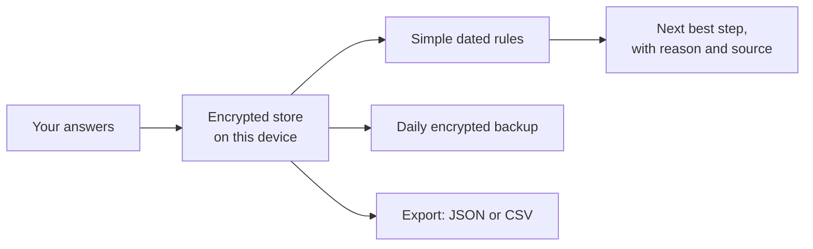

- Everything runs on your device. In this version nothing is sent anywhere: no bank links, no
  AI and no tracking.
- The rules are written down with their source and the date they were checked.
- Money is kept in each currency's smallest unit (pence, paise, fils), so sums never drift.

## 🔒 Your data

- **Where it lives:** in an encrypted file in the app's own data folder on this device.
- **What leaves the device:** nothing, unless you export or save a backup somewhere yourself.
- **Back it up:** **Settings → Backups → Back up now**, or choose a second folder there.
- **Delete it:** uninstall the app and remove its data folder.

> [!IMPORTANT]
> Keep your recovery key safe. If this device breaks or its saved key is lost, the recovery
> key is the only way to open your data and your backups. Samriddhi cannot show it again.

## ❓ FAQ and troubleshooting

<details>
<summary><b>I forgot my PIN</b></summary>

On the lock screen, press **Forgot your PIN? Use your recovery key**. Then set a new PIN in
**Settings → Lock**.
</details>

<details>
<summary><b>The app says my device key is missing</b></summary>

This happens on a new device, or after the system key store was reset. Type or paste your
recovery key on the screen that appears. Your data opens as before.
</details>

<details>
<summary><b>Why is my net worth "rough"?</b></summary>

It is only your cash minus the debts you told us about. It leaves out homes, pensions and
investments for now. It is a starting point, not a valuation.
</details>

<details>
<summary><b>I do not want a suggestion</b></summary>

Press **Not for me** and, if you like, say why. It stays hidden. To bring it back, press
**Show 1 hidden step** on the home screen, then **Show again**.
</details>

<details>
<summary><b>The animations make me feel unwell</b></summary>

Go to **Settings → Look → Motion** and pick **Calm**. Samriddhi also follows your device's
"reduce motion" setting.
</details>

## 🛠️ For developers

<details>
<summary><b>Build, test and screenshots</b></summary>

The app is [Tauri 2](https://tauri.app) with a Rust core (`core/`), a Rust shell
(`app/src-tauri/`) and a [Svelte 5](https://svelte.dev) interface (`app/src/`), sharing a
theme kit in `ui/`.

```bash
npm ci
cargo fmt --check
cargo clippy --workspace --all-targets -- -D warnings
cargo test --workspace
npm run check        # theme contrast check, svelte-check and TypeScript
npm test             # node --test for ui/ and app/
npm run build        # the web part
cd app && npx tauri build --bundles appimage
```

Screenshots come from the browser stand-in (`app/src/lib/mock.ts`), so every figure is made
up. With Chromium installed, run `npm run screenshots`. Set `CHROMIUM` if it is not at
`/usr/bin/chromium`.

Before every commit, run `bash scripts/check-public.sh`. It refuses secrets, home-folder paths,
private addresses and e-mail addresses. See [CHANGELOG.md](CHANGELOG.md) for what changed.
</details>

<details>
<summary><b>Credits</b></summary>

- [Tauri](https://tauri.app), [Svelte](https://svelte.dev) and [Rust](https://www.rust-lang.org)
- [SQLCipher](https://www.zetetic.net/sqlcipher/) through [rusqlite](https://github.com/rusqlite/rusqlite)
- [Lucide](https://lucide.dev) icons
- [Inter](https://rsms.me/inter/), [Sora](https://github.com/sora-xor/sora-font),
  [Plus Jakarta Sans](https://github.com/tokotype/PlusJakartaSans),
  [Fraunces](https://github.com/undercasetype/Fraunces) and
  [JetBrains Mono](https://www.jetbrains.com/lp/mono/) fonts
</details>

## Related

Samriddhi is part of BrahmaOS, a family of private, local-first apps.

| App | What it does |
| --- | --- |
| Artha | Day-to-day money: ledger, budgets and forecast |
| Arogya Swasthya | Your lifelong health records |
| Vinyasa | Organising the spaces you live in |

## License

[MIT](LICENSE).
